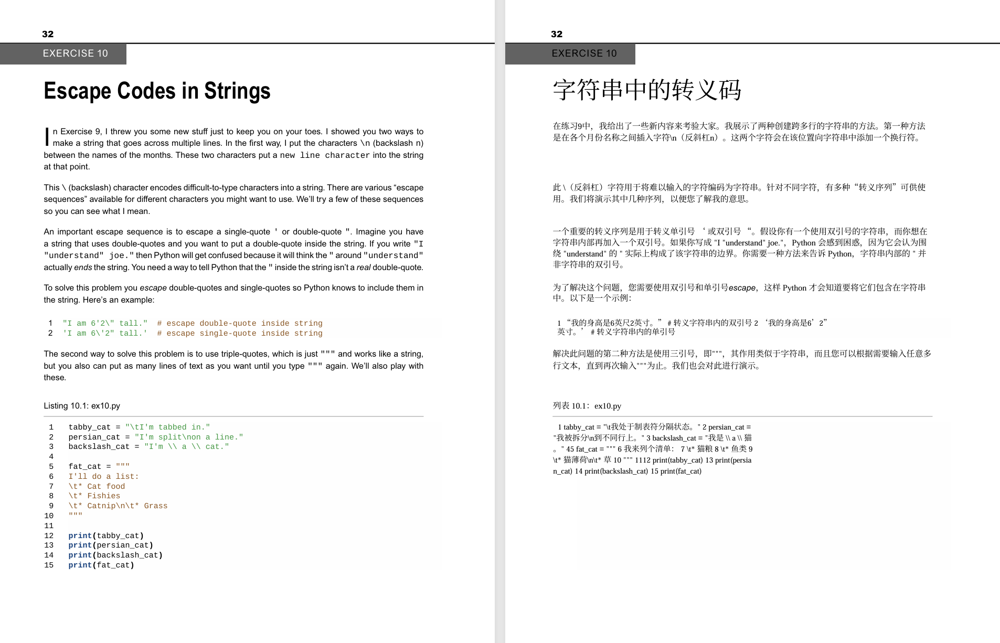
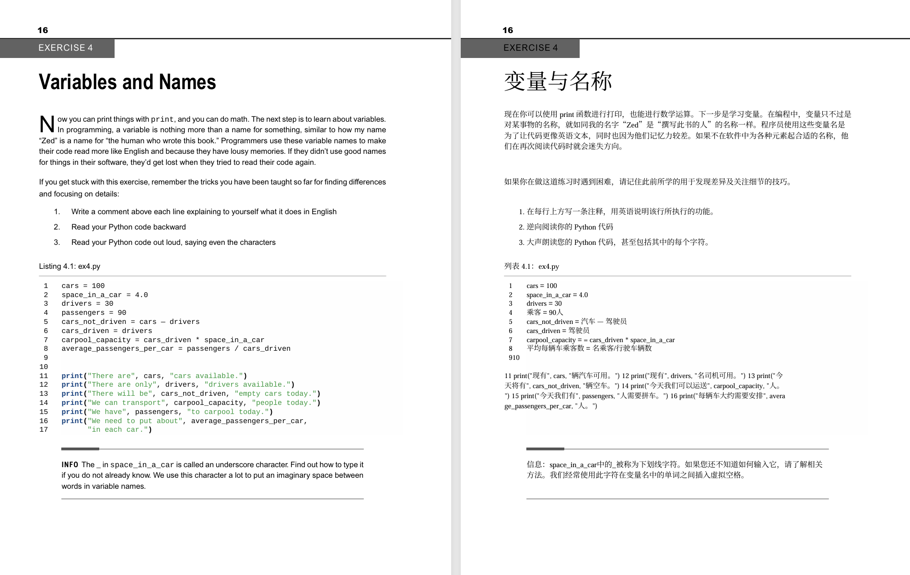
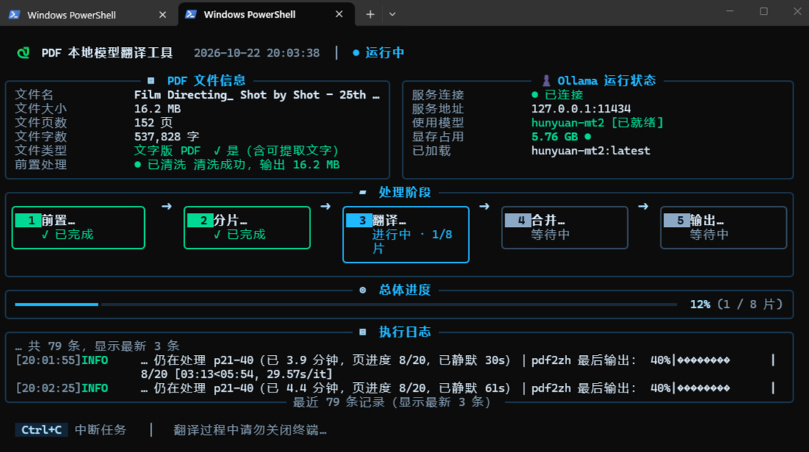

# scripthub

by deepseek-v4-flash + Hermes Agent

这是一个存放由 AI Agent 生成脚本的仓库，只用于分享特定需求的脚本，如果你的需求正好和脚本功能对得上，欢迎当作参考使用🤗

---

## 目录结构

```
scripthub/
├── python/
│   └── translate_pdf2zh.py   # pdf2zh + Ollama 本地模型翻译大型 PDF
├── docs/
│   └── images/
│       ├── panel.png         # 监控面板截图
│       ├── compare-1.png     # 原文/译文对照（一）
│       └── compare-2.png     # 原文/译文对照（二）
├── README.md
└── LICENSE
```

## python/translate_pdf2zh.py

用 [PDFMathTranslate (pdf2zh)](https://github.com/PDFMathTranslate/PDFMathTranslate) + Ollama 本地模型翻译大型 PDF 教材。单文件脚本，带 Rich 全屏分区式监控面板。

### 效果预览

同一页的原文与译文对照：





根据书本格式的不同，翻译的效果也会不一样。上图里代码内容可能会被模型强制翻译成不伦不类的内容。

### 功能

- **整本或指定页范围翻译**：按页切片（默认 20 页/片）逐片调用 `pdf2zh -s ollama`，单片翻完立刻落盘，不攒到最后
- **断点续跑**：每片完成即写入续跑清单 `<stem>.manifest.json`；中断后重跑同一命令，已完成片自动跳过，失败片自动重试；全部片成功后才合并（`--merge` 默认开启）
- **前置自检**：PDF 是否存在 / 页数 / 是否文字版 / 全书字数，Ollama 服务与指定模型是否就绪，`pdf2zh` 命令是否可执行
- **前置清洗**：重写 PDF 修掉非法 dict 键，规避 pymupdf 保存阶段崩溃（`--no-repair` 可跳过）
- **分片合并**：`garbage=4` + `clean` 清理重复与未引用对象，合并成功后默认删除分片目录（`--keep-chunks` 保留）
- **卡死可诊断**：单片超时、`pdf2zh` 打完 100% 后静默收尾、按页进度前进计时，判定「仍在推进」与「真卡死」
- **语言参数**：默认英译中，`--src-lang` / `--dst-lang` 可改；也接受 `English` / `中文` / `Chinese` / `zh-TW` 这类写法，脚本归一成 pdf2zh 语言代码
- **自定义翻译提示词**：`--prompt-file <文件>`，默认不启用

### 监控面板

TTY 下默认启用，五区分区显示，全部信息一屏看完：



| 分区 | 显示内容 |
|---|---|
| **PDF 文件信息** | 文件名、文件大小、页数、字数、是否文字版、前置清洗结果 |
| **Ollama 运行状态** | 服务连接状态、地址与端口、使用中的模型、显存占用、是否已加载 |
| **处理阶段** | 五个序号卡片：前置处理 → 分片文件 → 翻译内容 → 合并内容 → 输出 PDF，当前阶段高亮并显示进度 |
| **总体进度** | 全屏进度条 + 已完成片数 / 总片数 |
| **执行日志** | 带级别（INFO/WARN）与时间戳，显示最新几条；底部标注日志总条数 |

日志行会明确区分 **「输出静默」** 和 **「页进度静默」**，并附上 pdf2zh 的最后一行输出。这样你就不会把「模型正在吐字但还没换行」误判成「卡死」。

非交互环境（重定向、CI、管道）下自动退回普通滚动日志，也可以用 `--plain` 手动指定。

### 依赖

| 依赖 | 说明 |
|---|---|
| Python 3.12 | 3.13 有兼容风险 |
| `ollama` | 服务已启动，目标模型已 pull |
| `pdf2zh` | `pip install uv && uv tool install --python 3.12 pdf2zh` |
| `PyMuPDF` | 统计字数 / 裁剪 / 合并 / 预处理 |
| `rich` | 强依赖，缺失时直接报错并以退出码 4 结束（无降级实现） |

### 安装

```bash
pip install uv
uv tool install --python 3.12 pdf2zh
pip install pymupdf rich
```

### 用法

```bash
# 最简：整本翻译，模型用默认值
python translate_pdf2zh.py "book.pdf"

# 指定模型（不指定时：TTY 下交互选择已装模型）
python translate_pdf2zh.py "book.pdf" --model Hy-MT2

# 只自检不翻译：查 PDF 页数 / Ollama 服务与模型 / pdf2zh 是否可用
python translate_pdf2zh.py "book.pdf" --model Hy-MT2 --dry-run

# 只译前 5 页验质量，看版式与术语是否正常
python translate_pdf2zh.py "book.pdf" --model Hy-MT2 --probe-only

# 只译指定页范围（可多段，逗号分隔，越界部分自动裁掉）
python translate_pdf2zh.py "book.pdf" --pages 1-50
python translate_pdf2zh.py "book.pdf" --pages 1-5,20-30

# 非交互环境 / 重定向输出到文件时手动关面板，用普通滚动日志
python translate_pdf2zh.py "book.pdf" --model Hy-MT2 --plain > run.log 2>&1

# 调参：分片页数 / 单片超时 / 模型常驻时长 / 输出目录 / 保留分片 / 失败即停
python translate_pdf2zh.py "book.pdf" --model Hy-MT2 \
    --pages-per-chunk 10 --timeout 1800 --keep-alive 10m \
    --out-dir ./out --keep-chunks --stop-on-error

# 指定源语言与目标语言（默认英译中；也可写全称或中文）
python translate_pdf2zh.py "book.pdf" --src-lang English --dst-lang 中文

# 自定义翻译提示词（UTF-8，可含 ${lang_in} / ${lang_out} / ${text} 占位符）
python translate_pdf2zh.py "book.pdf" --prompt-file my_prompt.txt
```

### 常用参数

| 参数 | 默认值 | 说明 |
|---|---|---|
| `--model` | `Hy-MT2` | Ollama 模型名，TTY 下不填可交互选择 |
| `--pages` | 全本 | 页范围，如 `1-50` 或 `1-5,20-30` |
| `--pages-per-chunk` | `20` | 每片页数 |
| `--timeout` | `3600` | 单片超时（秒） |
| `--keep-alive` | `30m` | Ollama 模型常驻时长 |
| `--threads` | `1` | pdf2zh 并发线程，调高容易 OOM |
| `--out-dir` | PDF 同级 `output/` | 输出目录 |
| `--no-merge` | 关闭 | 不合并分片，保留加工中间态 |
| `--keep-chunks` | 关闭 | 合并后保留分片文件 |
| `--no-repair` | 关闭 | 跳过前置 PDF 清洗 |
| `--no-skip-subset-fonts` | 关闭 | 恢复字体子集化；默认跳过，因为超大 CJK 字体子集化开销超线性，且某些 PDF 会在此阶段永久挂死（产物反而小 13-16MB/册） |
| `--stop-on-error` | 关闭 | 任一片失败即停，不再尝试后续片 |
| `--plain` | 关闭 | 强制普通日志，不用面板 |

### ⚠️ 续跑的两个坑

1. **`chunks/` 必须还在**。跳过判定依据是 `chunks/` 里仍存在该片的 `-mono-sliced` / `-dual-sliced` 产物。合并成功且未加 `--keep-chunks` 时会删掉分片目录，此时清单虽仍标「已完成」，重跑会整本重译。
2. **默认 `--repair` 会让重跑永远全量重译**。产物文件名取自「当前翻译用的 PDF」，而 `--repair` 先生成 `<stem>_repaired.pdf` 再翻，产物因此叫 `<stem>_repaired-mono-sliced.pdf`，查找用的却是原始 `<stem>`，两者对不上，日志会提示「标记完成但产物已清理」。

需要续跑时两条一起用（实测可正常跳过）：

```bash
python translate_pdf2zh.py "book.pdf" --model Hy-MT2 --no-repair --keep-chunks
```

### 输出文件

翻译完成后在输出目录得到两个 PDF：

| 文件 | 内容 |
|---|---|
| `<stem>-mono.pdf` | 纯译文，单栏，页面尺寸与原文一致 |
| `<stem>-dual.pdf` | 原文 / 译文左右对照，便于校对 |

中断时 `chunks/` 里保留已完成的单片产物，续跑靠的就是它们。
